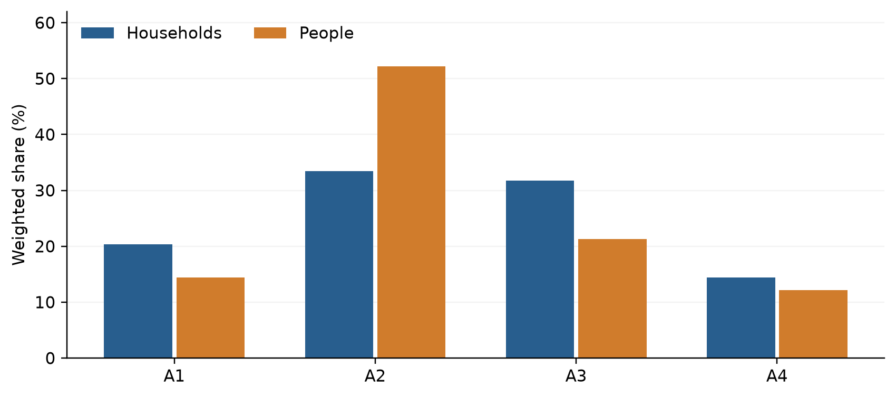
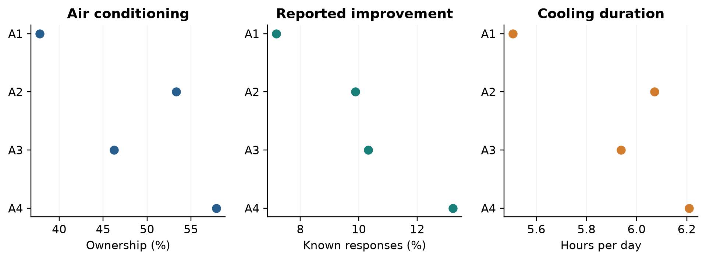
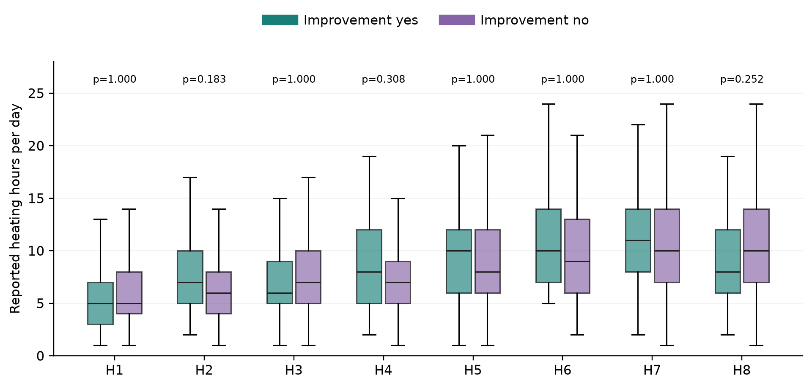
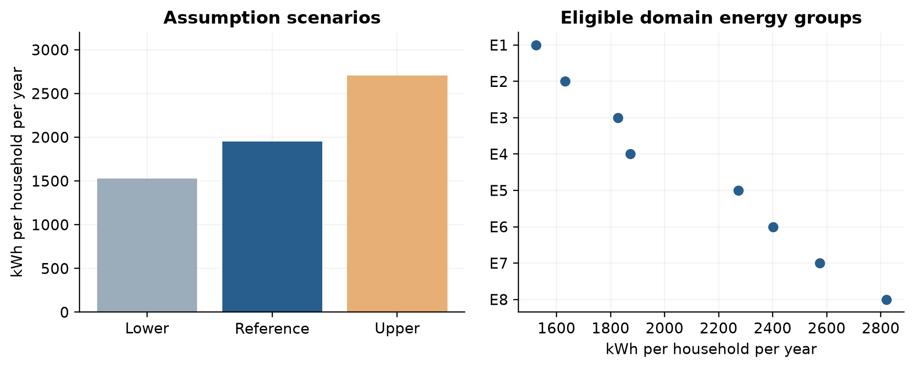
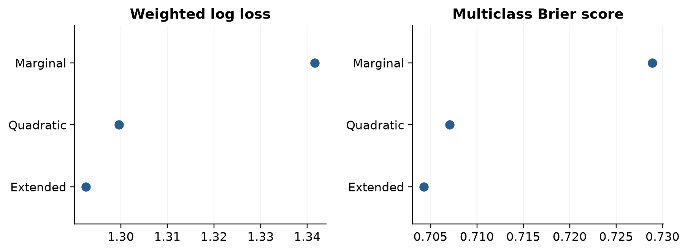

# Temporal transferability of Italian household energy archetypes between 2013 and 2021

## Implications for regional building stock modelling

## Abstract

Household archetypes provide a practical means of representing occupant diversity in building-energy models, but their usefulness over time depends on more than the persistence of recognizable demographic profiles. Changes in household composition, equipment ownership and operation may alter both the prevalence of archetypes and the energy-related characteristics associated with them. Building on the Italian household archetypes derived from the 2013 ISTAT energy survey and the regional ita-domes modelling framework, this study develops a repeated cross-sectional comparison with the 2021 survey. The framework distinguishes the transferability of the household classification from the calibration of its dwelling associations and operational inputs. It also separates observed survey responses from appliance electricity reconstructed under common reference parameters. The available 2021 analysis includes 52,632 eligible households from 54,069 records. Within this analytic population, weighted air-conditioning ownership is 48.6%, while reported insulation or window improvements account for 10.0% of households with known responses. Mean daily cooling duration is 5.97 hours among respondents in the relevant frequency categories. None of eight within-heating-group improvement contrasts remains statistically significant after multiplicity adjustment. Appliance reconstruction yields a full-release weighted reference estimate of 1,949 kWh per household per year, with substantial sensitivity to assumptions about unobserved detail. These findings establish an empirical basis for comparing household representations, while emphasizing the need to preserve response universes and measurement definitions. [RESULTS PENDING: insert frozen-model transfer, composition decomposition and paired regional simulation estimates.] The study's intended contribution is to establish when inherited archetypes can be reused, when recalibration is warranted, and whether updating household inputs changes regional retrofit assessments.

Keywords: household archetypes; residential energy; ISTAT; repeated cross-sectional surveys; temporal transferability; appliance electricity; building stock simulation.

## 1 Introduction

### 1 1 Household diversity and the use of archetypes

Residential energy models require a representation of the people who occupy buildings as well as the buildings themselves. The physical characteristics of a dwelling constrain heat transfer, installed systems determine how energy services are delivered, and household activities influence the timing and intensity of demand. A building of a given age, size and construction type can therefore accommodate markedly different patterns of energy use. These differences matter when models are used to compare interventions across a region, because an intervention acts on a building that is occupied and operated rather than on an envelope in isolation.

Household archetypes offer a manageable representation of this diversity. They summarize recurring combinations of demographic characteristics and provide a basis for associating households with dwelling attributes and operational patterns. Their practical attraction is that detailed person-level simulation is not required for every application. A regional model may need plausible distributions of operating hours and appliance ownership without needing to reproduce every daily activity of each resident. The appropriate level of behavioral detail consequently depends on the model output and the decision it is intended to support, as discussed by Mahecha Zambrano et al. [12].

An archetype is nevertheless a statistical representation of a population observed under particular conditions. Its usefulness does not follow indefinitely from its initial interpretability. A recognizable household profile may become more or less common, occupy different dwellings, or use different equipment. Changes in the survey instrument may also alter the information available to characterize the same profile. The question is therefore not simply whether the same number of clusters can be recovered in a later survey. It is whether an established representation continues to support its intended modelling functions when transported to a subsequent observation period.

This distinction is important for building-stock applications. Updating all model inputs can be expensive, while retaining all inherited assumptions can obscure changes in the population represented. A practical update strategy requires evidence about which components remain adequate. The demographic classification may be reusable even if its prevalence needs revision. Conversely, stable national archetype shares can coexist with changes in equipment ownership within each class. The empirical assessment must distinguish these possibilities rather than treating the archetype model as a single object that is either valid or obsolete.

### 1 2 Foundations in the Italian residential context

Khajedehi et al. [1] used the 2013 ISTAT survey to identify four Italian user archetypes and examine their relationships with dwelling characteristics and energy-related operation. The study established a demographic basis for representing households in building-energy applications and investigated how dwelling age and area could inform the probability of a particular user archetype occupying a dwelling. Its treatment of heating-system use and electricity-related differences connected demographic representation with variables relevant to simulation. The present study builds on that contribution by introducing a later survey wave and asking how the representation performs across observation periods.

A complementary development is ita-domes, described by Vivian et al. [2]. This bottom-up framework combines ISTAT household information, appliance-performance assumptions and geographically differentiated weather to simulate the Italian residential building stock. Its physical calculations draw on EUReCA [5] and on Italian building prototypes [6]. The CLIMA chapter compares aggregate energy consumption with national energy balances and presents regional distributions by end use and energy carrier. It therefore provides an appropriate setting for evaluating whether household-input updates have consequences beyond the statistical description of households.

These developments belong to an established Italian modelling tradition. MOIRAE introduced a survey-informed bottom-up representation of residential consumption and electrification pathways [3]. Subsequent work considered electrification under socio-demographic and economic constraints [4]. The value of adding a temporal household analysis cannot therefore rest on the general proposition that demographics matter for Italian residential energy demand. The narrower question addressed here is how an empirically established archetype representation transfers between survey waves and how the choice to retain or refresh its inputs affects a controlled modelling comparison.

The two foundational papers also operate at different representational levels. Household archetypes describe occupants; physical building archetypes describe the construction and geometry used in the energy calculation. Neither classification can substitute for the other. A successful connection requires an explicit assignment between them, with suitable probabilities where individual occupants are unknown. This assignment must preserve relevant relationships among demographic characteristics, dwelling properties and equipment rather than combining independently sampled attributes into implausible households.

### 1 3 Temporal comparison in the wider literature

Survey-derived archetypes and their integration into energy modelling are active areas of research. Li and Dogan [7] derive residential building archetypes and usage patterns from national energy-survey and urban data for reduced-order building simulation. Chen et al. [8] incorporate stochastic occupant-driven energy use into a bottom-up residential stock model. These studies demonstrate that the connection between survey evidence and physical simulation is already well established. A new Italian application must consequently specify the additional empirical question it answers.

Recent work also demonstrates the importance of household composition over time. Ramos-Martín and Matsumoto [9] examine changes in the distribution of household types and residential energy consumption in Spain between 2006 and 2023. Their subsequent analysis incorporates household composition into energy projections [10]. These contributions show why changes in household numbers and household types should be distinguished from changes in consumption conditional on type. They also indicate that a temporal decomposition alone would be an insufficient basis for claiming a new modelling framework.

A further line of work concerns the integration of heterogeneous information sources. Latifi et al. [11] develop probabilistic methods for creating behavior-aware synthetic building populations from demographic, building, time-use and weather information. Such approaches address the absence of common identifiers and the uncertainty introduced when datasets are combined. For the present study, the related challenge is not to identify the same family in two surveys. It is to maintain consistent meanings across independent samples and to evaluate the consequences of using their information in a common energy model.

Together, these studies motivate a focused contribution. We examine temporal transfer at the level of the household representation, distinguish composition from conditional-outcome differences, and connect the resulting update to paired stock simulations. The comparison also addresses the effect of changing survey detail on reconstructed appliance electricity. This last component is essential because an apparent change in an energy indicator can arise from a change in the available inputs even when the calculation uses the same nominal unit. The contribution lies in the empirical connection among these questions, rather than in claiming that occupant-aware simulation, demographic decomposition or national archetype development is itself unprecedented.

### 1 4 Objectives and scope

The study addresses four questions. First, how well does a common household representation describe the demographic profiles and prevalence observed in the two survey waves? Second, how much of a cross-wave difference in an energy-related outcome is associated with changing archetype composition rather than a change within archetypes? Third, how does a model transported from 2013 perform relative to recalibrated or newly fitted alternatives when evaluated on the same 2021 households? Fourth, under common physical and meteorological conditions, does updating the household representation change regional demand estimates or the relative savings associated with retrofit options?

The study uses a repeated cross-sectional design. The 2013 and 2021 records do not follow the same households, and the results cannot be interpreted as individual family transitions. The comparison provides a population-level temporal perspective. Collection years are also distinguished from the reference periods of individual questions, particularly where responses in the 2021 wave refer to 2020. These distinctions constrain the interpretation of change but do not prevent a useful assessment of model transfer.

The published 2013 results are retained as historical benchmarks with their original definitions. New cross-wave estimates require a common analytical specification and are identified separately. This separation preserves the contribution of the earlier study while allowing the later survey to answer a question that could not be addressed from one observation point. It also avoids interpreting differences between distinct estimators or population domains as demographic change.

## 2 Data and measurement

### 2 1 Survey sources and populations

The analysis draws on the ISTAT household energy surveys released for 2013 and 2021, together with their record layouts, questionnaires and accompanying statistical documentation [16,17]. The 2013 material supplies the empirical foundation of the earlier archetype study [1]. The 2021 release expands the available household sample and provides information on demographic characteristics, dwelling attributes, heating, cooling, equipment and energy-related investments. The record layout identifies variables and coding, while the questionnaire establishes the universe of respondents and the meaning of each answer. Both are required for interpretation.

The available 2021 release contains 54,069 records. The current demographic analysis retains 52,632 households satisfying its common-domain eligibility rules. The retained records have released weights summing to approximately 23.61 million households. This sum describes the coverage of the retained analytic domain; it should not be substituted for an independently verified total number of Italian households. Household records excluded because of the common-domain definition cannot be recovered merely by renormalizing the remaining weights.

The present classification is restricted to households with one to five members and the demographic information required by the common representation. The restriction supports comparability where larger households are top-coded, but it narrows the scope of inference. A national stock application covering all households must either extend the representation to the excluded domain or quantify that domain separately. Reporting the coverage explicitly is preferable to presenting a restricted-domain mean as an unrestricted national estimate.

Different outcomes require different subsets of these records. The dwelling-association models require available dwelling age and area proxies, cooling duration follows its own routing, and the insulation-improvement analysis excludes unknown responses. Table 1 distinguishes these denominators. This approach avoids an unnecessarily severe complete-case restriction in which a household missing one variable is removed from every analysis. It also makes it possible to identify whether an apparent difference between outcomes is partly attributable to different respondent populations.

Table 1. Available 2021 analysis populations. Counts are unweighted records unless otherwise stated. These are current repository results, not newly estimated cross-wave effects.

| Population or analysis | Records or quantity | Interpretation |
|---|---:|---|
| Full 2021 release | 54,069 | Starting records |
| Common demographic domain | 52,632 | Eligible for the current archetype representation |
| Sum of weights in this domain | 23.61 million | Weighted coverage, not an all-household census total |
| Training subset | 36,842 | Current demographic split |
| Tuning subset | 7,894 | Current demographic split |
| Test subset | 7,896 | Current demographic split |
| Known improvement response | 52,200 | Denominator for the improvement prevalence |
| Unknown improvement response | 432 | Excluded from that particular comparison |
| Routed cooling duration | 17,493 | Respondents in frequency categories 1 to 3 |
| Dwelling probability test subset | 6,954 | Complete required predictors within the test subset |

### 2 2 Reference periods and observation conditions

The wave label is not a universal outcome date. Some variables describe equipment or dwelling characteristics at the time of interview, whereas other questions concern use or expenditure in an earlier period. The official 2020–2021 release explicitly associates energy expenditure with 2020 [17]. Cooling duration in the current analysis also follows questions concerning summer 2020. Comparisons must therefore attach a reference period to the variable rather than assume that every 2021 record describes operation during calendar year 2021.

This matters because a two-wave comparison spanning the pandemic cannot isolate a long-term behavioral trend from a period-specific change in household circumstances. More time spent at home, altered routines and other contemporaneous factors could affect reported operation, but the survey comparison alone does not establish their individual effects. We therefore use the term conditional-outcome change rather than behavioral change when interpreting the residual component of a decomposition. This wording leaves room for changes in technology, climate, reporting and unobserved circumstances.

Weather is addressed differently in the empirical and simulation parts of the study. Reported operating hours are observations under the conditions experienced by respondents and cannot be converted into climate-neutral behavior by relabelling them. In the physical model, common weather can be imposed to compare the consequences of two input representations. That controlled comparison is a model experiment, not a retrospective reconstruction of what would have happened to the same households under another year's weather.

The two surveys may also differ in their collection procedures. Such differences are relevant when response tendencies or coverage change, although the present data do not necessarily identify a separate survey-mode effect. Where mode is available, distributions and outcome patterns can be examined as a sensitivity analysis. Any resulting association should remain distinct from an estimate of an interview-mode treatment effect. The purpose is to assess whether the central conclusions depend strongly on an observable feature of data collection.

### 2 3 Harmonizing demographic and dwelling information

Cross-wave harmonization begins with the construct being measured. Variables are classified as directly comparable, comparable after aggregation, newly available, or unavailable for a particular construct. A shared topic does not guarantee equivalence. Two questions about heating can refer to different systems or respondent groups; two questions about insulation can distinguish current perceived quality from a recent intervention. The crosswalk therefore records response options, skip conditions, units and reference periods in addition to the variable codes.

The demographic representation uses the youngest and oldest household age proxies, household size and an education-related proxy. Age classes are mapped to documented representative values. These quantities describe intervals rather than exact ages, and their means must be read with that limitation. Education is harmonized to a common attainment representation; its numerical scale is not treated as interchangeable with every education index that appeared in an earlier analysis. The principal role of these variables is to support a consistent demographic space across waves.

Dwelling information includes construction period, floor-area category, dwelling type and geographical location. Construction period and floor area are represented by documented proxies where exact values are unavailable. A building-age proxy requires particular care: retaining the same construction cohort across waves does not imply retaining the same numerical building age. The mapping must use the relevant reference date consistently or work directly with construction-period categories. This decision affects temporal comparisons of occupancy probabilities and should be fixed before evaluating transfer.

The level of geographical detail used in the statistical analysis must also be compatible with the released microdata. Regional identifiers do not locate each dwelling within a municipality or establish its exact climatic zone. Provincial weather or physical-stock information can be introduced through an explicit allocation model, but such allocation adds assumptions. A map of regional mean heating hours is consequently different from a map of household-specific weather-normalized heat demand, even if both concern space heating.

### 2 4 Cooling equipment and operation

Cooling is represented through separate ownership and use variables. The ownership indicator establishes whether a household has air-conditioning equipment within the questionnaire's definition. Frequency and duration provide conditional information about operation among respondents for whom those questions apply. Their separation avoids treating a missing duration as zero consumption or interpreting a mean among regular users as the mean among all households.

In the current 2021 analysis, the ownership estimate uses all 52,632 eligible records, of which 24,073 report air conditioning. The weighted estimate differs from the simple sample fraction because households have unequal released weights. Daily duration is summarized for 17,493 respondents in the relevant frequency categories. The resulting mean is therefore conditional on both the presence of equipment and the questionnaire's operational routing. The group of households contributing to ownership and the group contributing to duration should remain visible in every comparison.

The distinction is also relevant to simulation. A change in ownership affects the number of dwellings potentially using cooling, whereas a change in duration affects operation among users. Equipment type and efficiency influence the conversion from cooling service to electricity. These mechanisms should not be collapsed into a single survey indicator. Where the survey provides only coarse time information, generating an hourly schedule requires assumptions about the placement of operating hours; it does not create directly observed hourly behavior.

### 2 5 Insulation and reported improvements

Insulation is a particularly important example of the need for construct-level harmonization. The 2013 subjective insulation-quality question concerns respondents' assessment of their dwelling. The 2021 combined insulation/window-improvement field concerns reported intervention activity. A household can report no recent improvement while living in a well-insulated building, or report an improvement without providing enough information to characterize the resulting thermal resistance. These answers must not be interpreted as direct measurements of an envelope's present thermal properties.

For the 2021 analysis, the combined improvement response is interpreted with its parent investment question. The existing processing distinguishes reported improvement, no reported improvement and unknown information. The known-response denominator is 52,200, with 432 eligible households classified as unknown. Only the known-response cases enter the yes/no improvement comparison. Unknown records remain available to other analyses when their required information is present.

The heating-group visualization uses two colors whose labels identify the observed construct. We distinguish reported insulation/window improvement from no reported insulation/window improvement. The yes/no legend is accompanied by a caption stating the full construct. For a cross-wave intervention comparison, the 2013 intervention questions must be aggregated to the same set of measures and reference window. Until this mapping is complete, the 2021 comparison is informative in its own right but is not evidence of a temporal difference in the effect of insulation.

The statistical comparison concerns reported heating hours. These hours are not equivalent to heat demand, delivered energy or thermal comfort. An improved envelope may reduce energy required per operating hour, permit a different temperature, or be associated with households that operate their systems for longer. Consequently, neither a positive nor a negative association with hours identifies the causal energy effect of insulation. Physical retrofit experiments and observational hour comparisons address different questions and should be interpreted separately.

### 2 6 Reconstructed appliance electricity

Appliance electricity is reconstructed from survey information on equipment and use combined with external performance assumptions inherited from the Italian modelling workflow. The approach follows the device-based logic described in the earlier modelling literature [2,3]. Depending on the appliance, the calculation uses ownership, number of devices, operating time, cycle frequency or an annual reference consumption. The output is expressed in kWh per household per year, but it is not a meter reading.

The current reconstruction preserves the earlier component boundary and reference parameterization. Its audit reproduces all 20,000 saved 2013 totals to numerical precision, with a maximum absolute difference of approximately 1.82 × 10⁻¹² kWh. This agreement verifies the implementation against that saved calculation. It does not establish the accuracy of the underlying parameter values or validate the result against measured household electricity. Keeping these forms of validation separate is essential when the same model is used to produce an outcome that is subsequently analyzed statistically.

The 2021 instrument does not retain every detail used in the earlier appliance calculation. The reconstruction therefore uses documented assumptions for missing lighting durations, refrigerator capacity and multiplicity, small-appliance demand and aspects of computer use. It also maps available age categories and infrequent-use answers to the reference model. Alternative settings are used to examine sensitivity. Because these settings are deliberately selected assumptions rather than random draws from an estimated probability distribution, their range is not a confidence interval.

For temporal interpretation, a common parameterization defines a standardized appliance-electricity requirement. It answers how ownership and reported use translate into electricity when evaluated using the same reference assumptions. It does not by itself measure the change in actual electricity consumption or the improvement in appliance efficiency between the survey years. A historical-efficiency analysis would require an independently supported parameter set for each period, with uncertainty attached to both the parameters and the missing survey detail.

Table 2. Measurement distinctions used throughout the article.

| Quantity | Evidence | Permitted interpretation |
|---|---|---|
| Heating hours | Reported system use | Operating duration within the specified survey universe |
| AC ownership | Reported equipment | Equipment prevalence, not electricity demand |
| Cooling hours | Routed reported duration | Conditional operation among eligible respondents |
| Insulation/window improvement | Reported intervention | Recent activity, not measured current insulation quality |
| Appliance kWh | Survey inputs plus reference coefficients | Standardized model estimate, not metered use |
| Simulated heating energy | Physical model plus assigned inputs | Model outcome under stated conditions |
| Published 2013 benchmark | Original article | Historical result under its original definition |

## 3 Analytical framework

### 3 1 A common reference representation

The temporal comparison uses a common demographic reference space. Transformations and cluster centers are fitted to the 2013 training data and then held fixed when assigning 2021 households. This procedure gives the cluster labels a consistent statistical meaning within the harmonized analysis. It prevents a change in label ordering or a rotation of separately estimated components from being mistaken for a population change. The four-class structure also preserves a direct conceptual connection with the earlier archetype study [1].

The use of a fixed reference does not imply that every later household is equally well represented. Some 2021 observations can lie outside the range of demographic values encountered in the reference data or at comparatively large distances from the reference centers. These observations should be flagged and described. A nearest-center assignment remains mechanically possible outside the reference range, but the certainty attached to its interpretation should not be the same as for a household close to a well-populated reference region.

Two complementary summaries are required. Weighted archetype shares describe the prevalence of the reference classes, while conditional demographic distributions describe the households assigned to each class. A stable share can conceal a change in the composition of the class, and a changing share can occur while its conditional profile remains similar. Means provide an accessible summary, but quantiles and distribution plots are useful where broad age categories or mixed family structures make averages difficult to interpret.

An independently fitted 2021 representation provides a sensitivity analysis rather than the sole temporal comparator. Its labels need explicit alignment with the reference classes, and any difference in the number of classes changes the comparison. The objective is to determine whether retaining the common representation materially constrains description or prediction. A more complex representation should not be preferred solely because it improves fit on the data used to estimate it.

### 3 2 Weighting and target populations

Released household weights are used to estimate household-level prevalence and means in the specified analytic domain. People-weighted shares are calculated by multiplying the household weight by household size before aggregation. These two summaries answer different questions. Household-weighted shares describe how dwellings are occupied, whereas people-weighted shares describe how residents are distributed across household types. Neither should be substituted for the other in regional stock calculations.

Unequal weights also affect the precision of estimates. The current eligible 2021 dataset has a weight-based effective sample size of approximately 23,054, compared with 52,632 retained records. This quantity summarizes concentration in the weights and is useful for diagnosing sparsity. It is not a complete design effect because the full sampling design may introduce additional dependence. Reported record counts, weighted population coverage and effective sample size should therefore remain distinguishable.

For cross-wave comparisons, weighting is applied within an explicitly defined common domain. Comparisons can then be standardized to a common distribution of geography or dwelling characteristics when the question requires it. Standardization is not an automatic improvement: it changes the estimand from the observed composition of each wave to a controlled population mixture. Both the unstandardized population contrast and the standardized contrast can be informative if their meanings are stated clearly.

### 3 3 Associating households with dwellings

The dwelling-association model estimates the probability of a household archetype conditional on available dwelling characteristics. This direction is relevant when an energy model knows the dwelling but lacks direct information about its occupants. Construction-age and area proxies enter a multinomial specification, with an extended model additionally using broad location and dwelling type. Probabilities are constrained to be positive and to sum to one across the four archetypes. A training-marginal model supplies a reference prediction that does not use dwelling-specific information.

The distinction between predicting an archetype from a dwelling and predicting a dwelling from an archetype is substantive. A model intended for stock assignment must use the appropriate conditional direction or apply a justified probabilistic transformation. Once an archetype has been assigned, equipment and operational inputs may require additional conditional models. Sampling each variable independently from its archetype mean would ignore relationships that can influence both electrical demand and internal gains.

The current workflow separates training, tuning and test data. The reported 2021 probability scores are evaluated on households with the required predictors in the test subset. Weighted log loss and the multiclass Brier score summarize predictive performance, while calibration examines agreement between predicted probabilities and observed frequencies. Lower scores indicate better predictions within the same outcome and test set. The absolute value of a Brier score also depends on its convention; here it is the multiclass score used consistently across the compared specifications.

These within-wave results should not be presented as a temporal transfer test. The latter requires applying a frozen 2013 model to 2021 observations and comparing it with alternatives fitted using permitted 2021 training information. The test set must remain identical across alternatives. An improvement from adding location within a 2021 fit does not establish how much accuracy would be lost by transporting a model estimated from the earlier wave.

### 3 4 Temporal transfer and the value of recalibration

The planned transfer experiment distinguishes three strategies. The first retains the demographic transformation, archetype assignment and conditional models estimated from 2013. The second retains the common archetype structure but recalibrates conditional models using 2021 training data. The third fits a 2021-specific representation and associated models, with careful alignment of the outcomes being predicted. This comparison asks whether updating the relationships attached to an established classification captures most of the available gain or whether changing the classification itself is useful.

All strategies must be evaluated on the same 2021 test households using the same information set. Otherwise, a gain can reflect additional predictors or a different eligible population rather than temporal recalibration. Where the richer 2013 instrument provides more information than the later survey, the principal transfer comparison uses variables available in both waves. A separate richer-input comparison can quantify the benefit of information that is unavailable in the deployment setting.

Predictive metrics are selected according to the outcome. Archetype probabilities are evaluated with proper probability scores and calibration. Heating or cooling duration models require errors expressed in their original units and checks of the predicted distribution. Appliance-kWh predictions concern a modeled target; their predictive accuracy establishes consistency with the reconstruction, not correspondence with measured demand. Regional and archetype-specific scores reveal whether an apparently small aggregate difference conceals important deterioration in a subset of households.

Uncertainty is evaluated for paired score differences rather than inferred from two unrelated intervals around separate models. When feasible, resampling should include the estimation steps whose uncertainty is relevant to the claim. A fixed-model evaluation conditions on the fitted representation, while a full-pipeline resampling exercise includes its estimation variability. These are different assessments and should be labelled accordingly. [ANALYSIS PENDING: the frozen 2013 versus recalibrated 2021 comparison has not yet been run for this manuscript.]

### 3 5 Decomposing differences between survey waves

For a common set of archetypes, the population mean of an outcome is the sum of each archetype's share multiplied by its conditional mean. A change between waves can therefore arise because the shares change, because conditional means change, or because both occur. A symmetric decomposition assigns the share difference the average of the two conditional means and assigns the conditional-mean difference the average of the two shares. The resulting components sum exactly to the overall mean difference. This follows the logic of classical rate decomposition [14].

The composition component describes how the outcome would change through the reallocation of population shares across the common archetypes, averaged across the two observed conditional-outcome structures. The conditional component describes the change within those classes, averaged across the two share distributions. The symmetric form avoids privileging one wave as the sole reference. For national energy totals, the change in the number of households must be considered separately from the change in per-household demand.

The interpretation remains descriptive. A conditional difference can reflect equipment changes, prices, weather, survey response, family circumstances or changes within a broad archetype that the classification does not resolve. It is therefore not an identified behavioral or technological effect. The decomposition is useful because it organizes the observed difference and helps target subsequent modelling experiments, not because it recovers causal mechanisms from two cross-sections.

For outcomes with relevant tails, distributional counterfactual methods can extend the comparison beyond means [15]. Such methods require adequate overlap and additional modelling choices. The principal analysis should begin with the transparent mean identity and assess whether conclusions depend on heterogeneous distributional changes. Sparse regional cells should be pooled or left unreported according to prespecified support rules. [ANALYSIS PENDING: insert the harmonized weighted decomposition and uncertainty estimates.]

### 3 6 Information detail in the appliance calculation

The appliance analysis requires an additional controlled comparison because input detail differs between waves. The proposed experiment applies the 2021 information constraints to the 2013 households and reconstructs their electricity using the same rules used for the later survey. Each 2013 household then has a richer-input reference estimate and a coarsened-input estimate under common coefficients. Their paired difference isolates the effect of the information treatment for those households, holding population and nominal parameterization fixed.

This exercise is more informative than assuming that use of the same calculation code guarantees comparability. For example, replacing observed device capacity with an average capacity can change the variance of reconstructed consumption even when it preserves the mean approximately. Replacing several device types with the main reported type can affect high-use households differently from low-use households. Consequently, the assessment should examine component means, dispersion, archetype-specific differences and changes in energy-group assignment.

The main temporal indicator then uses the common reduced information set in both waves. A supplementary analysis retains the richer 2013 calculation to show the information available in the published baseline and its practical value. A historically parameterized reconstruction constitutes another comparison and should not be mixed with the constant-parameter analysis. Separating these dimensions allows the article to distinguish ownership/use differences, information-detail sensitivity and assumptions about technological performance.

The current alternative appliance scenarios vary several assumptions together. Their results are useful for exposing the possible scale of sensitivity but do not attribute it to individual inputs. A component-by-component perturbation can identify which assumptions dominate and whether the same assumptions matter for all archetypes. [ANALYSIS PENDING: the paired 2013 coarsening experiment and the common-information temporal contrast are not yet available.]

### 3 7 Heating groups and improvement contrasts

The current energy-group workflow compresses combinations of archetype, dwelling type and broad location into groups with similar training outcomes. Group complexity is selected using tuning data, and group outcomes are summarized on held-out records. The resulting heating groups are operational summaries, not independent demographic archetypes. Their labels refer to the fitted grouping and must not be assumed to match identically numbered groups from a separate fit or the published 2013 analysis.

Within each fixed 2021 heating group, the improvement contrast is estimated by weighted least squares with a binary improvement indicator and heteroskedasticity-consistent HC3 covariance. The coefficient is the weighted difference in reported heating hours between households reporting an improvement and those not reporting one. The test family comprises eight group-specific contrasts, and Holm adjustment is applied to control multiplicity within that family. The analysis excludes unknown improvement responses before evaluating the contrasts.

The figure presents the distributions rather than only their means. Weighted boxplots use two colors for the known yes/no categories, with adjusted p-values above the groups. Table 6 reports signed differences and record counts, since improvement-positive groups can be much smaller than comparison groups. A confidence interval should accompany the coefficient in the final version; the currently saved contrast table provides point differences and p-values but not those intervals.

These comparisons are intentionally modest in interpretation. They ask whether reported heating hours differ within the empirical groups. They do not estimate the counterfactual heating energy that the same dwelling would use without an improvement. A causal analysis would require additional design and information, while an engineering savings estimate requires a physical specification of the intervention. Both are distinct from the cross-sectional comparisons reported here.

### 3 8 Regional simulation experiments

The proposed physical extension uses ita-domes as the common calculation framework [2], within the wider field of stock-based savings assessment reviewed by Brøgger and Wittchen [13]. Heating and cooling calculations use the chosen reduced-order model, while appliance, cooking and hot-water components retain explicit end-use boundaries. The household representation supplies demographic assignments, equipment distributions and operational inputs where individual occupants are unknown. Before integration, the interface must be checked for energy accounting, especially where appliance electricity also contributes to internal gains. The same physical quantity must not be counted twice as delivered energy.

The minimum experiment holds the physical stock and weather fixed while comparing a standard household-input treatment, a 2013-derived treatment and a 2021-derived treatment. This isolates the model consequence of the input representation under common conditions. It is different from comparing a historical 2013 simulation with a historical 2021 simulation, where physical stock, climate and technology would all change. The controlled experiment should be completed before interpreting a difference as the value of refreshing household inputs.

A more extensive design crosses household-input vintage with physical-stock vintage. Such a factorial comparison can distinguish the consequences of changes in people-related inputs from changes in building and system characteristics and can reveal interactions between them. It is appropriate only when both physical-stock representations are supported by the data. Missing envelope information should be addressed through documented prototype assignment and sensitivity, rather than inferred directly from a yes/no recent-improvement response.

The retrofit comparison considers envelope improvement, heating-system replacement and their combination under identical eligibility and engineering assumptions across household-input treatments. Annual savings are evaluated by region and, where supported, by archetype. Total regional savings and savings per eligible dwelling answer different planning questions and are reported separately. Rank stability is assessed across uncertainty realizations; a small numerical reversal between nearly equivalent options should not be presented as a decisive change in priority. [SIMULATIONS PENDING: these paired regional and retrofit experiments have not been executed for this draft.]

### 3 9 Validation and uncertainty

Validation is organized by the quantity being evaluated. Reproduction of saved appliance totals checks implementation. Held-out household predictions assess statistical generalization within a specified target. Agreement with national energy balances concerns aggregated model outputs under defined population, carrier and time boundaries. None of these checks automatically substitutes for the others. In particular, a model can reproduce national electricity while distributing consumption incorrectly across end uses or household groups.

Historical validation requires weather and activity inputs that correspond to the benchmark period. The ita-domes chapter uses observed-year replacements for a subset of provinces and discusses the implications for the warmer comparison year [2]. The new analysis should preserve that transparency by stating the coverage of updated weather rather than describing a partial replacement as complete national weather normalization. The carrier definitions must also be reconciled with the selected balance source before comparing totals.

Uncertainty arises from survey sampling, proxy construction, missing-detail assumptions, conditional assignment and physical model parameters. These sources should be investigated separately before any combined interval is reported. Released weights support population estimation but do not by themselves recover all features of a complex survey design. Where design identifiers or replicate weights are unavailable, the inferential results are described as model-based or conditional on the available design information.

The principal comparison is the difference between alternative representations under matched conditions. Paired simulations can share weather, physical parameters and random draws where appropriate, reducing numerical noise in that difference. Sensitivity scenarios remain separate from statistical confidence intervals unless they are embedded in a justified probabilistic model. This distinction helps readers determine whether a conclusion reflects sampling variability, a plausible modelling choice or an unverified assumption.

## 4 Results

### 4 1 The published reference and the available later wave

The published 2013 study identified four household profiles distinguished by age structure, household size and education [1]. Table 3 reproduces the demographic means from its published Table 3. These values provide the historical reference for interpreting the scope of the archetype approach. The profiles cover small older households, larger households with younger members, and smaller households differentiated by age and education. Their usefulness lies in representing recurring combinations of characteristics rather than assigning a definitive social identity to every household.

Table 3. Historical demographic benchmarks reproduced from Table 3 of Khajedehi et al. [1]. Values are the published means, not the later harmonized estimates. Age proxies are expressed in years. The education scale belongs to that publication and is not directly compared with the current harmonized proxy.

| Published cluster | Youngest age proxy | Oldest age proxy | Household members | Published education index |
|---|---:|---:|---:|---:|
| 1 | 70.2 | 78.3 | 1.8 | 0.5 |
| 2 | 21.2 | 57.2 | 3.7 | 0.7 |
| 3 | 46.0 | 63.0 | 2.3 | 0.5 |
| 4 | 55.6 | 72.2 | 2.1 | 0.8 |

The distinction between household and population shares was already visible in the published analysis. Its first cluster represented 40.1% of sampled households and 29.9% of people, whereas the second represented 26.9% of households and 40.2% of people [1]. These are the published sample-based shares under that study's specification. Their contrast illustrates how household size changes the interpretation of prevalence. They are not subtracted from the weighted 2021 estimates below, because that operation would combine different analytical definitions and weighting conventions.

The later release provides substantial information for extending the comparison. The retained demographic sample contains 52,632 records, while outcome-specific populations remain large enough to support national descriptive summaries and selected subgroup analyses. Nevertheless, 3,189 retained records are flagged as outside the reference range in the current transformation. The flag identifies records needing closer support assessment; it does not automatically establish that their assignments are unusable. The rate and nature of these cases should be examined alongside any transfer-performance result.

The cross-wave evidence is therefore best presented in two stages. The historical benchmark establishes continuity with the published study, while a common-specification comparison will quantify change. This draft reports the available 2021 empirical results and preserves the historical values without turning their juxtaposition into a longitudinal estimate. [CROSS-WAVE RESULTS PENDING: insert the common-specification 2013 and 2021 weighted shares, profile differences and support diagnostics.]

### 4 2 Household profiles in 2021

The current 2021 assignments retain marked differences in household size and age composition. Archetype 1 consists on average of 1.59 members, with youngest and oldest age proxies of 73.63 and 81.22 years. Archetype 2 is larger, with 3.50 members on average and age proxies of 14.50 and 49.84 years. Archetype 3 contains 1.50 members on average, with age proxies of 56.26 and 62.50 years. Archetype 4 averages 1.89 members, with age proxies of 38.84 and 51.64 years. These summaries describe the current common-reference assignments rather than a newly established set of household identities.

Archetype 2 has the largest weighted household share, 33.48%, followed by Archetype 3 at 31.76%. Archetypes 1 and 4 account for 20.36% and 14.39%, respectively. Weighting by people changes this distribution considerably. Archetype 2 represents 52.20% of people within the analytic domain, compared with 14.42%, 21.27% and 12.11% for Archetypes 1, 3 and 4. The difference reflects the larger household size of Archetype 2 and demonstrates why dwelling-level assignment requires household shares rather than person shares.

Table 4. Current 2021 archetype summaries under the harmonized reference representation. These are weighted summaries of the eligible domain. Age values are interval-derived proxies. No direct numerical change from Table 3 is implied.

| Archetype | Records | Household share % | People share % | Members | Youngest age | Oldest age |
|---|---:|---:|---:|---:|---:|---:|
| A1 | 8,767 | 20.36 | 14.42 | 1.59 | 73.63 | 81.22 |
| A2 | 18,738 | 33.48 | 52.20 | 3.50 | 14.50 | 49.84 |
| A3 | 15,771 | 31.76 | 21.27 | 1.50 | 56.26 | 62.50 |
| A4 | 9,356 | 14.39 | 12.11 | 1.89 | 38.84 | 51.64 |

Figure 1. Household and people shares of the current 2021 archetypes. Both use released household weights; people shares additionally account for household size. The population is the eligible demographic domain. These are descriptive point estimates, without survey-design confidence intervals.

The profiles provide an interpretable basis for studying equipment and operating differences, but descriptive separation is not a test of temporal adequacy. The same assignments could be useful for one task and less useful for another. For example, household size may support appliance-demand differentiation while providing limited information about the duration of heating in a dwelling with particular thermal properties. The transfer experiment must therefore evaluate outcomes separately rather than infer general adequacy from the demographic summary alone.

### 4 3 Cooling ownership and conditional operation

Within the eligible 2021 domain, weighted air-conditioning ownership is 48.57%. Ownership varies across the current archetypes, from 37.79% in A1 to 57.89% in A4. A2 and A3 lie between these values, at 53.32% and 46.26%. These estimates are descriptive and do not isolate the contribution of age, household size, dwelling type or location. They do, however, establish that applying one national ownership probability to every archetype would discard observable variation in the survey.

Conditional cooling duration varies less than ownership. The overall weighted mean is 5.97 hours per day among the routed frequency categories, with archetype means of 5.51, 6.07, 5.94 and 6.21 hours for A1 through A4. The underlying record counts differ, ranging from 2,225 for A1 to 6,976 for A2. These conditional means should not be multiplied by a universal annual number of days without an explicit model for the frequency response and cooling season.

The distinction between ownership and duration suggests a useful decomposition of cooling-related inputs. Even when mean daily duration among users is relatively similar across profiles, differences in ownership can alter how many dwellings contribute to cooling electricity. Equipment efficiency and climatic conditions then affect the conversion to demand. A physical model that updates duration but retains an outdated ownership distribution could consequently miss an important source of input change.

Table 5. Available 2021 cooling and improvement indicators. Percentages are weighted. Cooling duration is conditional on the questionnaire routing. Improvement percentages exclude unknown responses.

| Archetype | AC ownership % | Cooling duration h/day | Cooling records | Improvement % | Known improvement records |
|---|---:|---:|---:|---:|---:|
| All | 48.57 | 5.97 | 17,493 | 9.96 | 52,200 |
| A1 | 37.79 | 5.51 | 2,225 | 7.18 | 8,647 |
| A2 | 53.32 | 6.07 | 6,976 | 9.88 | 18,616 |
| A3 | 46.26 | 5.94 | 4,672 | 10.33 | 15,625 |
| A4 | 57.89 | 6.21 | 3,620 | 13.21 | 9,312 |

Figure 2. Air-conditioning ownership, reported insulation/window improvement and conditional cooling duration in the eligible 2021 population. The panels have distinct units and response universes. Points represent weighted descriptive estimates, not adjusted causal effects. Cooling duration concerns the routed summer 2020 responses.

The official ISTAT releases provide an external context for equipment prevalence [16,17], but differences between their published totals and this analytic sample must be interpreted with regard to eligibility and weighting. Agreement is useful as a broad processing check. It does not make the analytic domain identical to the full target population, nor does it validate the inferred hourly schedules that may later be used in simulation.

### 4 4 Heating groups and reported improvements

Among households with known information, 5,687 report an insulation or window improvement, corresponding to a weighted prevalence of 9.96%. The prevalence ranges from 7.18% in A1 to 13.21% in A4. This pattern describes reported intervention activity within the current archetypes. It does not establish that A4 has the best-performing envelope or that A1 has the poorest insulation. Those interpretations would require information about the pre-existing envelope and the nature and effectiveness of the intervention.

The eight held-out heating groups show weighted mean operation between approximately 6.17 and 11.03 hours per day. Their labels represent the outcome-based grouping of archetype, location and dwelling-type cells. The differences between group means should therefore be read as the performance of a compressed operational representation. The two highest groups have almost identical test means despite distinct training summaries, illustrating why the final group labels should not be treated as an exact ordering of every unseen household's use.

The estimated within-group improvement contrasts have mixed signs. The largest negative point difference is in H8, at −1.77 hours per day, while the largest positive difference is in H4, at 1.61 hours per day. H2 and H8 have unadjusted p-values below 0.05, but neither remains below that threshold after Holm adjustment over the eight comparisons. The smallest adjusted p-value is 0.183. No group therefore provides evidence of a difference at the conventional 5% level after the specified multiplicity adjustment.

Table 6. Within-group contrasts in reported heating hours for the 2021 held-out sample. Differences are improvement yes minus no, estimated with weighted least squares and HC3 covariance. The test family contains eight contrasts. Unknown responses were excluded upstream; a zero unknown count within these groups does not mean that the source survey had no missing responses.

| Group | Yes records | No records | Difference h/day | Raw p | Holm p |
|---|---:|---:|---:|---:|---:|
| H1 | 140 | 1,241 | −0.085 | 0.890 | 1.000 |
| H2 | 87 | 853 | 1.153 | 0.023 | 0.183 |
| H3 | 103 | 832 | −0.482 | 0.380 | 1.000 |
| H4 | 71 | 551 | 1.614 | 0.051 | 0.308 |
| H5 | 179 | 1,377 | 0.027 | 0.955 | 1.000 |
| H6 | 35 | 272 | 1.154 | 0.334 | 1.000 |
| H7 | 134 | 880 | 0.295 | 0.665 | 1.000 |
| H8 | 69 | 481 | −1.768 | 0.036 | 0.252 |

Figure 3. Weighted distributions of reported daily heating hours by 2021 heating group and known insulation/window-improvement response. Two colors distinguish yes and no; unknown responses are excluded. Boxes show weighted quartiles and whiskers follow the 1.5-interquartile-range convention. Holm-adjusted p-values refer to the HC3 weighted contrasts in Table 6, not to a test of the boxplot medians. Outlier points are omitted for readability.

The absence of adjusted statistical significance is not evidence that insulation has no physical value. First, the indicator concerns intervention reporting rather than a measured change in envelope properties. Second, the outcome is hours of operation rather than delivered heat. Third, the improvement-positive samples are relatively small in some groups, particularly H6. The available result supports a narrower conclusion: these data do not show a consistent, multiplicity-adjusted difference in heating duration associated with reported improvements within the specified groups.

The mixed point differences also discourage imposing an assumed direction when translating the survey into physical inputs. Reducing heating hours automatically for every household reporting an improvement would embed a behavioral response that the present comparison does not establish. Physical changes in thermal performance can instead be represented in the building model while operational responses are explored as separate scenarios where evidence is insufficient.

### 4 5 Appliance electricity and assumption sensitivity

The reconstructed appliance indicator has a weighted mean of 1,949.19 kWh per household per year across all 54,069 records in the 2021 release. The corresponding alternative-assumption calculations yield 1,527.12 and 2,705.67 kWh. These values use the full release, not the restricted archetype domain, and are reported here to describe the reconstruction audit. A temporal archetype comparison must recalculate summaries on its common eligible population rather than combine these full-release quantities with restricted-domain statistics.

Relative to the reference calculation, the lower assumption setting reduces the mean by approximately 21.7%, while the upper setting increases it by approximately 38.8%. The asymmetry follows the selected parameter changes and should not be interpreted as an asymmetric statistical confidence interval. The range demonstrates that coarser information about devices and use can have a material effect on the reconstructed level. It does not indicate that the true household mean lies within those endpoints with a specified probability.

Table 7. Appliance reconstruction sensitivity across the full 2021 release. The three settings retain a common component boundary and differ in documented assumptions about missing information. They are scenarios, not confidence limits.

| Assumption setting | Weighted mean kWh/household/year | Difference from reference |
|---|---:|---:|
| Lower scenario | 1,527.12 | −21.7% |
| Reference | 1,949.19 | Reference |
| Upper scenario | 2,705.67 | +38.8% |

The current electricity-group analysis, which uses the eligible demographic domain and a held-out sample, produces group means from 1,524.29 to 2,820.83 kWh per household per year. These groups characterize variation in the reference-model outcome. They should not be used as measured annual electricity profiles, and their separation partly reflects the reconstruction's use of demographic and equipment inputs. The analysis remains useful for testing how a compact representation approximates the modeled distribution, provided this dependence is acknowledged.

Figure 4. Full-release appliance-electricity estimates under three assumption settings and held-out reference-model electricity-group means. The panels use different populations and answer different questions: reconstruction sensitivity versus variation among eligible-domain energy groups. Scenario endpoints are not confidence limits, and no measured-electricity validation is implied.

A substantive temporal conclusion requires the additional coarsening experiment described in Section 3. Without it, changes in the number and types of appliances are not fully separated from the effect of replacing missing detail with reference assumptions. The paired experiment will be especially informative for components whose heterogeneity is compressed by the later instrument. Its results may show that the aggregate mean is relatively insensitive while archetype rankings or distribution tails are more affected, or the reverse. Neither outcome should be assumed in advance.

### 4 6 Dwelling association and prediction

The current 2021 dwelling-association models outperform the training-marginal reference on the same held-out set of 6,954 households. The quadratic dwelling model has a weighted log loss of 1.300 and Brier score of 0.707. Adding broad location and dwelling type gives values of 1.293 and 0.704, compared with 1.342 and 0.729 for the marginal model. These results indicate that the available dwelling information contributes predictive information about archetype assignment within this 2021 analysis.

The gain from the extended specification over the quadratic model is modest in aggregate. This observation does not establish that location and dwelling type are unimportant in every subgroup. A small average change can conceal improved calibration in some parts of the stock and little benefit elsewhere. It also does not justify treating the scores as direct evidence of better physical energy predictions. The statistical model predicts archetype membership; its usefulness for energy depends on the consequences of the resulting assignments.

Table 8. Available within-wave 2021 predictive scores for archetype probabilities. All specifications use the same 6,954 eligible test households. Lower values indicate better scores. These results are not a comparison between frozen 2013 and updated 2021 models.

| Specification | Weighted log loss | Multiclass Brier score |
|---|---:|---:|
| Training marginal | 1.342 | 0.729 |
| Quadratic dwelling model | 1.300 | 0.707 |
| Quadratic plus location and type | 1.293 | 0.704 |

Figure 5. Held-out probability scores for the available 2021 specifications. The two panels use distinct score scales. They show within-wave predictive comparisons and do not yet quantify temporal transfer or the uncertainty of paired score differences.

The planned T0–T2 experiment will place these within-wave results in a temporal setting. A frozen model could retain good calibration, require only a prevalence update, or show a more substantial change in its conditional relationships. The analysis must distinguish these possibilities before recommending that the archetype structure be replaced. [TRANSFER RESULTS PENDING: insert the frozen 2013 model, the common-structure 2021 recalibration and the aligned 2021 refit, evaluated on an identical untouched test set with paired uncertainty.]

### 4 7 Composition and conditional changes

[DECOMPOSITION RESULTS PENDING: report the common-domain 2013 and 2021 mean for each harmonized outcome, the total difference, the composition component, the conditional-outcome component and their uncertainty. Verify that the components sum to the reported total.]

The final interpretation of this section will depend on the relationship between the two components. If the composition component accounts for much of the difference, changing prevalence of established household profiles will be central to the update. If the conditional component dominates, revising the operating and equipment distributions attached to the profiles will be more important. Opposite-signed components would indicate that a small overall change conceals offsetting developments. The present descriptive results do not determine which of these patterns holds.

The decomposition should be reported for heating duration and standardized appliance electricity only after their universes and measurement definitions are aligned. Cooling requires ownership and conditional operation to remain separate. A change in mean hours among routed users cannot be interpreted as a population-wide cooling-intensity change without accounting for the selection into ownership and frequency categories. Regional decomposition will be limited to cells with adequate support rather than extrapolated mechanically to every region.

### 4 8 Consequences for regional energy and retrofit assessment

[SIMULATION RESULTS PENDING: report updated-minus-inherited energy estimates under common weather and physical stock, followed by savings for the same envelope and heating-system interventions. Include regional totals, per-eligible-dwelling quantities and uncertainty in option rankings.]

The comparison will answer whether observed input differences survive aggregation and affect the practical use of the model. Several outcomes are possible. The update may change household-level distributions while leaving regional totals largely stable. It may alter electricity more than heating because equipment ownership changes are more influential than operating-duration changes. It may also affect retrofit savings without strongly changing baseline totals if the update is concentrated in the buildings eligible for a particular intervention. These are interpretations to evaluate against the simulation outputs, not findings of the present draft.

Historical and controlled simulations will be reported separately. A weather-controlled difference estimates the consequence of changing the input representation in the model. A historical comparison additionally reflects the selected weather, physical stock and technology assumptions for each period. Keeping the two distinct allows the paper to discuss temporal change without attributing every difference in energy to occupants. A national total will be reported only after the excluded household domain and energy-balance boundaries have been reconciled.

## 5 Discussion

### 5 1 What an archetype should retain over time

The available results support the usefulness of a differentiated household representation for describing the 2021 analytic population. Household size, age structure, cooling ownership and reported improvements vary across the current archetypes, while dwelling characteristics contribute information about their assignment. These observations provide a substantive basis for the next stage of transfer assessment. They do not, on their own, establish that the complete 2013 model can be transported without updating its parameters.

Temporal adequacy has several meanings. A classification can remain recognizable in demographic terms, preserve useful ordering of energy-related characteristics, and still become miscalibrated in prevalence. Alternatively, its shares can remain similar while the equipment distributions within classes change. For stock modelling, the relevant criterion is whether retaining the representation produces acceptable errors in the quantities required by the application. This criterion may differ between annual energy accounting, end-use allocation and retrofit comparison.

The distinction helps avoid an unnecessarily disruptive update strategy. Re-estimating every component can break continuity with the earlier model and make temporal interpretation harder. Retaining every component can preserve an interpretable vocabulary while concealing calibration drift. Comparing frozen, recalibrated and newly fitted strategies provides evidence for choosing between these options. The established archetypes remain the scientific foundation of that comparison, rather than a baseline included merely to be displaced.

A finding of limited benefit from updating would be valuable if demonstrated under an appropriate test. It would identify a domain in which the representation remains useful and where resources might be better spent improving other inputs. Conversely, a concentrated deterioration in particular household or dwelling groups would support targeted recalibration. The aim is to identify where additional information changes model performance, not to assume that the newest representation is necessarily superior for every task.

### 5 2 Composition and operation as distinct sources of change

The contrast between household and people shares illustrates why demographic change must be represented at the correct unit. Residential stock models typically assign households to dwellings. A large household archetype can account for a majority of people while representing a much smaller fraction of occupied dwellings. Applying person shares directly to dwellings would alter the implied distribution of occupants and could affect appliance demand, internal gains and hot-water requirements. The prevalence measure must therefore follow the modelling unit.

The proposed decomposition complements this accounting distinction by separating changes in prevalence from changes within the reference classes. Recent Spanish evidence has already demonstrated the importance of household-composition analysis for residential demand [9,10]. The present study extends that line of inquiry toward the maintenance of an empirical household representation used in a physical stock model. Its value will depend on showing how decomposition results inform an actual input update rather than treating the components as an endpoint.

Broad archetypes inevitably retain internal heterogeneity. A change in the conditional mean of A2, for example, can reflect different compositions within that class as well as changed operation by comparable households. Finer conditioning on geography, dwelling characteristics or equipment can clarify the pattern, but it also increases sparsity and model dependence. The analysis must balance explanatory detail against the support available in both waves. A very granular decomposition is not automatically more informative if it relies on substantial extrapolation.

For this reason, causal language is avoided. The conditional component does not identify a pure preference effect, and the composition component does not isolate a demographic intervention. The decomposition organizes a population-level contrast under a chosen representation. Physical experiments then ask what particular input changes imply within the energy model. Keeping these two steps separate makes the interpretation more precise and permits each to be assessed using appropriate evidence.

### 5 3 Cooling as a distinct update problem

Cooling demonstrates why updating one operational average is insufficient. The 2021 archetypes differ substantially in ownership while their conditional daily durations are closer together. For simulation, the ownership distribution determines which households contribute to cooling demand, and duration describes only part of their operation. Climatic exposure, equipment type, efficiency and the number of occupied rooms add further dimensions. A representation that matches average daily duration can still misrepresent cooling electricity if it assigns equipment to the wrong parts of the stock.

The combination of survey information and physical modelling is useful precisely because neither source provides the complete answer. The survey describes ownership and reported use, while the thermal model represents the relationship between indoor conditions, envelope properties and weather. However, their connection requires assumptions about the timing of use and control conditions. The resulting hourly profiles are model outputs constrained by survey evidence, not observations of household behavior at hourly resolution.

This qualification matters when discussing electrification and flexibility. Annual or daily information may support an annual cooling-energy assessment, but it does not by itself validate coincident peaks or demand-response potential. Such claims would require additional time-resolved information or independent validation. The present article can establish the sensitivity of annual regional cooling estimates to updated household information without extending its claims to grid flexibility that the source data do not directly resolve.

### 5 4 Interpreting insulation and heating hours

The heating-group comparisons provide no consistent multiplicity-adjusted association between reported improvement and heating duration. This result should be interpreted in relation to the question asked. The improvement field combines intervention types and does not measure the thermal performance achieved. Heating hours likewise describe operation rather than the amount of energy delivered. Their association is therefore an incomplete indicator of the energy consequences of envelope improvements.

Longer operation among some improved households would not necessarily contradict an energy-saving effect. Improved comfort, different system controls or household circumstances could coexist with lower energy required to maintain a given temperature. Shorter operation would also not establish savings without information on weather, temperature and system performance. These possibilities explain why reported hours should not be used as a direct surrogate for retrofit effectiveness.

The exclusion of unknown responses is appropriate for the requested yes/no comparison, but it does not make missingness irrelevant. Households unable to report an improvement may differ from those with known responses. The excluded proportion and observable characteristics should therefore be examined, especially if the missingness pattern differs across waves. Any sensitivity analysis should remain specific to the improvement question; removing these households from unrelated appliance or demographic summaries would unnecessarily change those populations.

The physical retrofit analysis can proceed without imposing an unsupported behavioral effect. It can modify documented envelope properties under a common operational treatment, then examine alternative operational responses as scenarios. This makes the distinction between engineering performance and household response explicit. It also avoids labelling all households with no reported recent intervention as physically uninsulated, a classification that would misrepresent both the survey and the stock.

### 5 5 Appliance electricity and the value of information

The appliance calculation reveals a different limitation: apparently precise energy units can conceal uncertain inputs. A reconstructed value reported to the nearest kWh may depend on average device capacities, reference powers and imputed durations. The sensitivity range in the current 2021 reconstruction is large enough to warrant attention before interpreting cross-wave differences. Precision in numerical computation should not be confused with precision in the representation of household demand.

The successful reproduction of saved 2013 totals is nevertheless useful. It establishes that the inherited calculation has been traced and implemented consistently, allowing the comparison to focus on inputs and assumptions rather than unexplained numerical differences. This supports continuity with the previous modelling work. The next step is to identify how the reduced survey detail influences the results, using the same households and coefficients in a paired coarsening experiment.

That experiment can inform future data collection as well as the present article. If a missing detail strongly affects regional or archetype-level estimates, collecting or externally validating it may have greater value than refining a parameter with little influence. The ranking of influential inputs should be based on the intended output. A device characteristic that barely changes the national mean may still be important for high-consumption households or for an intervention targeting a particular appliance category.

The constant-parameter indicator also provides a useful analytical choice when interpreted correctly. It removes one source of variation in the conversion from survey responses to electricity and makes ownership/use differences easier to examine. A historical-efficiency track would answer a different question about the combined influence of technology and operation. Presenting the two as separate analyses would be more informative than mixing parameter vintages and then attributing the resulting difference entirely to household behavior.

### 5 6 Relevance for regional model maintenance

The regional application is intended to show whether improved household representation changes a decision-relevant quantity. A national mean alone can be insensitive to changes that are concentrated geographically or within the eligible stock for a retrofit. Regional totals also reflect household numbers, so per-dwelling quantities are needed to distinguish scale from intensity. Both views are relevant, but they should not share an interpretation merely because they are plotted on similar maps.

The ita-domes framework provides a suitable basis for this assessment because it combines household information with physical calculations and regional reporting [2]. The extension proposed here is a controlled comparison of input treatments and the resulting retrofit outcomes. Earlier Italian electrification research already integrates demographic and economic considerations [4]; the present contribution is to evaluate the empirical value of refreshing an established survey-derived representation using a later observation wave.

An update policy could be selective. Archetype prevalence might be refreshed from a suitable population source, equipment ownership from a new survey, and the conditional dwelling model retained if its predictive calibration remains adequate. Such modular maintenance is plausible but must be justified by the transfer results. The current draft does not establish which combination is best. It specifies comparisons that can identify where additional estimation effort produces a meaningful change in predictions or simulation outcomes.

Retrofit rankings deserve particular care. A change in rank is more persuasive when the difference in savings is appreciable relative to uncertainty and when eligibility is held constant. A rank reversal caused by nearly equal values should be described as uncertainty rather than a policy recommendation. Cost-optimal or equity-based rankings would require additional inputs and objectives beyond annual energy savings. The article should therefore state exactly which decision criterion is evaluated before using the term priority.

### 5 7 Limitations and generalizability

The repeated cross-sectional design is the central inferential limitation. It supports comparisons between population distributions but not observations of how individual families changed. Household formation, dissolution and movement between dwellings can alter the cross-sectional composition without appearing as identifiable transitions. Consequently, a flow diagram linking individual 2013 archetypes to individual 2021 archetypes would misrepresent the data. Shared labels describe common reference classes, not linked households.

The two observation periods also cannot separate a secular trend from a temporary period effect. This is especially relevant where the 2021 survey asks about 2020 operation. Additional waves would help assess whether patterns persist, although a later survey introduces another harmonization problem rather than removing the need for one. The present comparison remains valuable as an empirical test of transport to a distinct observation period, provided its scope is not inflated into a continuous historical trajectory.

Measurement changes are a further constraint. Some constructs can be harmonized by aggregation, while others cannot be treated as equivalent. Coarsening may reduce information even where it preserves the nominal variable name. Missingness and survey routing influence the respondent universe, and proxy values cannot supply detail that was never observed. The article therefore preserves a distinction between the full-release population, the common demographic domain and each outcome-specific subset.

The energy outputs have their own evidence limits. Appliance electricity is reconstructed, and physical stock simulations depend on prototype assignments, operating schedules, system efficiencies and weather coverage. Aggregate validation can identify inconsistencies but cannot establish every household-level mechanism. Uncertainty should reflect these limitations where feasible, and conclusions should be confined to quantities for which the model has appropriate support. Claims about actual household savings, comfort responses or peak flexibility would require additional evidence.

Finally, transferability beyond Italy is methodological rather than automatic. The principles of freezing a reference representation, harmonizing variables and testing the value of recalibration can be applied elsewhere. The fitted household profiles, coefficients and equipment assumptions are specific to the population and information sources used here. Generalization should therefore concern the evaluation procedure, not the untested transport of Italian archetypes to other countries.

## 6 Conclusions

The comparison of Italy's 2013 and 2021 household energy surveys provides an opportunity to extend established household archetypes from a single-wave description to an explicit assessment of temporal transfer. The published archetype study supplies the demographic foundation, while ita-domes supplies a regional physical modelling framework. Connecting them requires common measurement definitions and a distinction between preserving the household classification and updating the relationships attached to it.

The available 2021 results demonstrate substantial heterogeneity in household composition and equipment. Within the current eligible domain, air-conditioning ownership ranges from approximately 37.8% to 57.9% across archetypes, and conditional cooling duration is close to six hours per day overall. Reported insulation or window improvements account for approximately one tenth of known responses. The eight within-heating-group contrasts do not retain statistical significance after Holm adjustment, supporting a cautious interpretation of improvement-related differences in reported operation.

The appliance reconstruction establishes computational continuity with the earlier model but remains sensitive to assumptions needed for coarser survey information. Its full-release reference estimate of approximately 1,949 kWh per household per year is a standardized model quantity, not a measured national consumption trend. A paired information-detail experiment is required before the cross-wave difference can be interpreted independently of those assumptions.

[CONCLUSION PENDING: insert the direction, magnitude and uncertainty of the temporal transfer, decomposition and regional retrofit results. Do not claim that updating improves prediction or changes priorities until these experiments are complete.]

The final assessment should determine which parts of the established representation remain useful and which require recalibration. A finding of stability would support continued use within a defined domain; a finding of concentrated change would identify where updates are most valuable. In either case, the contribution is a transparent basis for maintaining household representations in regional energy models while preserving continuity with the evidence from the earlier survey.

## Data and code availability

The study uses ISTAT microdata and the associated documentation under their applicable access conditions. The final release should provide the harmonization specification, model parameters, analysis scripts, aggregate figure data and a versioned reproducibility manifest, without redistributing restricted household-level records. The appliance reconstruction should identify the reference database and source-code version used. [AUTHOR ACTION: confirm repository release, microdata access statement, author contributions, acknowledgements and funding before submission.]

## References

1. Khajedehi MH, Vivian J, Zarrella A. Identification of Italian user archetypes for building energy simulations based on a national survey. Energy and Buildings. 2025;344:115924. https://doi.org/10.1016/j.enbuild.2025.115924

2. Vivian J, Prataviera E, Carnieletto L, Pasut W, Zarrella A. A model to Simulate the Energy Consumption of the Italian Residential Building Stock with Regional Resolution. Proceedings of the 15th REHVA HVAC World Congress CLIMA 2025. Lecture Notes in Civil Engineering. 2026;788:1302–1311. https://doi.org/10.1007/978-3-032-10546-2_123

3. Besagni G, Borgarello M, Premoli Vilà L, Najafi B, Rinaldi F. MOIRAE – bottom-up MOdel to compute the energy consumption of the Italian REsidential sector: Model design, validation and evaluation of electrification pathways. Energy. 2020;211:118674. https://doi.org/10.1016/j.energy.2020.118674

4. Besagni G, Premoli Vilà L, Borgarello M, Trabucchi A, Merlo M, Rodeschini J, Finazzi F. Electrification pathways of the Italian residential sector under socio-demographic constrains: Looking towards 2040. Energy. 2021;217:119438. https://doi.org/10.1016/j.energy.2020.119438

5. Prataviera E, Romano P, Carnieletto L, Pirotti F, Vivian J, Zarrella A. EUReCA: An open-source urban building energy modelling tool for the efficient evaluation of cities energy demand. Renewable Energy. 2021;173:544–560. https://doi.org/10.1016/j.renene.2021.03.144

6. Carnieletto L, et al. Italian prototype building models for urban scale building performance simulation. Building and Environment. 2021;192:107590. https://doi.org/10.1016/j.buildenv.2021.107590

7. Li C, Dogan T. Deriving high-fidelity residential building archetypes and typical usage patterns from national energy use surveys to enhance initial guesses for Urban Building Energy Model inputs. Proceedings of Building Simulation 2025. https://doi.org/10.26868/25222708.2025.1336

8. Chen J, et al. Stochastic simulation of occupant-driven energy use in a bottom-up residential building stock model. Applied Energy. 2022;325:119890. https://doi.org/10.1016/j.apenergy.2022.119890

9. Ramos-Martín J, Matsumoto S. Impact of changes in the distribution of household types on residential energy consumption in Spain, 2006–2023. Energy and Buildings. 2026;358:117250. https://doi.org/10.1016/j.enbuild.2026.117250

10. Ramos-Martín J, Matsumoto S. Living smaller, consuming more? The energy implications of aging and shrinking households in Spain. Energy Research & Social Science. 2026;135:104660. https://doi.org/10.1016/j.erss.2026.104660

11. Latifi M, Zucca C, Willemsen MC. Beyond archetypes: Creating behavior-aware synthetic building populations through probabilistic multi-source data integration for multi-domain urban analysis. Building and Environment. 2026;302:114872. https://doi.org/10.1016/j.buildenv.2026.114872

12. Mahecha Zambrano J, Filippi Oberegger U, Salvalai G. Towards integrating occupant behaviour modelling in simulation-aided building design: Reasons, challenges and solutions. Energy and Buildings. 2021;253:111498. https://doi.org/10.1016/j.enbuild.2021.111498

13. Brøgger M, Wittchen KB. Estimating the energy-saving potential in national building stocks – A methodology review. Renewable and Sustainable Energy Reviews. 2018;82:1489–1496. https://doi.org/10.1016/j.rser.2017.05.239

14. Kitagawa EM. Components of a Difference Between Two Rates. Journal of the American Statistical Association. 1955;50(272):1168–1194. https://doi.org/10.1080/01621459.1955.10501299

15. Chernozhukov V, Fernández-Val I, Melly B. Inference on Counterfactual Distributions. Econometrica. 2013;81(6):2205–2268. https://doi.org/10.3982/ECTA10582

16. ISTAT. I consumi energetici delle famiglie Anno 2021. 2022. https://www.istat.it/comunicato-stampa/i-consumi-energetici-delle-famiglie-anno-2021/

17. ISTAT. Consumi energetici delle famiglie Anni 2020–2021. 2022. https://www.istat.it/comunicato-stampa/consumi-energetici-famiglie-anni-2020-2021/
